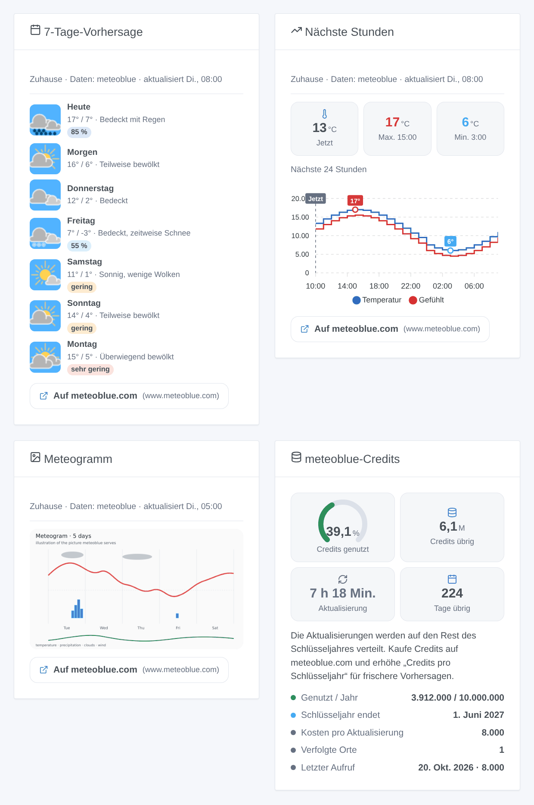
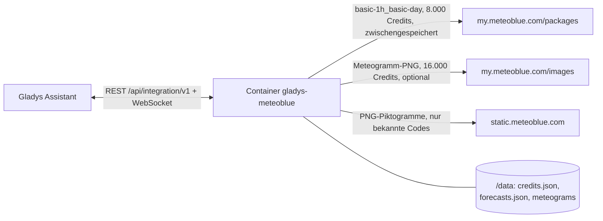
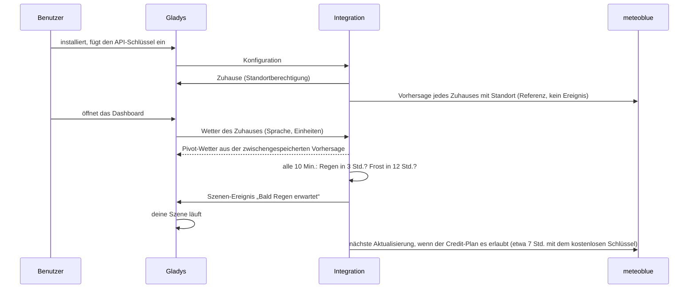

# Gladys Meteoblue

[English](README.md) · [Français](README.fr.md) · **Deutsch** · [Español](README.es.md)

[](LICENSE)
[](https://github.com/William-De71/gladys-meteoblue/releases)
[](https://github.com/William-De71/gladys-meteoblue/actions/workflows/release.yml)
[](https://gladysassistant.com)


Externe Integration für [Gladys Assistant](https://gladysassistant.com), die die **Forecast API von meteoblue** zu einem Wetteranbieter von Gladys macht: das Wetter der aktuellen Stunde, Vorhersagen über 24 Stunden und 7 Tage mit der Vorhersagbarkeit von meteoblue, Regen- und Frost-Auslöser, Szenen-Aktionen, vier Dashboard-Widgets und das meteoblue-Meteogramm. Sie läuft mit dem kostenlosen Weather-API-Schlüssel von meteoblue (10 Millionen Credits im Jahr) und verteilt diese Credits selbst über das Jahr.

Benutzerdokumentation: [English](docs/en.md) · [Français](docs/fr.md) · [Deutsch](docs/de.md) · [Español](docs/es.md).

> Community-Integration, weder mit meteoblue AG verbunden noch von ihr unterstützt. **Noch nie mit einem echten API-Schlüssel getestet**: Sie folgt der Referenz der meteoblue-API genau, Rückmeldungen sind willkommen. Der kostenlose Schlüssel gilt nur für nicht-kommerzielle Nutzung.

## Funktionen

- **Wetteranbieter** (Typ `weather`): Die Wetterkarte und der Chat-Assistent von Gladys nutzen ihn anstelle des eingebauten OpenWeather-Dienstes. Temperatur, gefühlte Temperatur, Luftfeuchtigkeit, Luftdruck, Wind, UV-Index, Tag oder Nacht (von meteoblue), Sonnenauf- und -untergang (berechnet); 24 Stunden und 7 Tage; metrische oder US-Einheiten.
- **Szenen-Auslöser**: Regen (oder Schnee) in den nächsten 3 Stunden, Frost in den nächsten 12 Stunden, je Zuhause; meteoblue-Credits bei 75, 90 oder 100 %.
- **Szenen-Aktionen**: die Vorhersage eines Tages (bis in 6 Tagen, mit ihrer Vorhersagbarkeit), das aktuelle Wetter, „wird es in den nächsten Stunden regnen?“.
- **Widgets**: eine 7-Tage-Vorhersage mit den meteoblue-Piktogrammen und der Vorhersagbarkeit, ein Verlauf der nächsten 12 bis 48 Stunden, das Meteogramm, das Credit-Budget.
- **Meteogramm** (optional, standardmäßig aus): das 5-Tage-Meteogramm von meteoblue, in der Wetterkarte und in seinem Widget.
- **Credits im Griff**: Ein Aufruf (8.000 Credits) versorgt alles; das Aktualisierungsintervall wird aus den bis zum Ende des Schlüsseljahres übrigen Credits berechnet; Vorhersagen und Zähler bleiben in `/data` (ein Neustart kostet nichts); eine harte Jahresobergrenze; eine Schaltfläche **API-Schlüssel testen**.
- Englisch, Französisch, Deutsch und Spanisch überall.



## Funktionsweise






Es gibt kein Gerät zu entdecken: Ein Wetteranbieter beantwortet die Wetteranfragen von Gladys, die die Koordinaten des Zuhauses enthalten.

### Transport

Nur Cloud (`transports: ["cloud"]`, Abzeichen „Cloud“ im Katalog): Jede Anfrage verlässt dein Netzwerk zu meteoblue mit den auf etwa 100 m gerundeten Koordinaten des Zuhauses. Die Piktogramme lädt der Container, Gladys liefert sie aus: Der Browser kontaktiert meteoblue nie.

### Credits und Aktualisierung

meteoblue zählt Credits, keine Aufrufe ([Referenz der Forecast API](https://my.meteoblue.com/packages/redoc), „Credits and Call Limits“, geprüft am 2026-10-20):

| Aufruf                                                       | Credits | Mit den kostenlosen 10 Millionen im Jahr                   |
| ------------------------------------------------------------ | ------- | ---------------------------------------------------------- |
| Aktualisierung der Vorhersage (stündlich + 7 Tage, 1 Aufruf) | 8.000   | etwa 3 am Tag für ein Zuhause, etwa alle 7 Std.            |
| Meteogramm-Bild (optional)                                   | 16.000  | 24 Std. behalten = 5,8 Millionen im Jahr, das halbe Budget |
| „API-Schlüssel testen“                                       | 8.000   | auf Anfrage                                                |

Die Integration zählt die Kosten, die meteoblue für jede Antwort angibt (Header `MB-Credits-Accounted`), verteilt die übrigen Credits auf den Rest des Schlüsseljahres (2 % als Reserve) und aktualisiert jedes Zuhause mit Standort, wenn der Plan es erlaubt, nie öfter als die eingestellte Untergrenze. Die Pakete „current“ und „sun & moon“ gehören nicht zur kostenlosen Testphase: Die aktuelle Stunde kommt aus der stündlichen Vorhersage (von meteoblue mit Stationen, Radar und Satellit korrigiert), die Sonnenzeiten werden berechnet.

## Voraussetzungen

- Gladys **5.2.0** oder neuer (ältere Versionen können die Integration nicht installieren: Widgets, Szenen und Zuhause-Auswahl).
- Ein Zuhause mit Standort in Gladys.
- Ein meteoblue-Konto mit **Weather-API**-Zugang (die kostenlose Testphase: Account overview → Weather API), für nicht-kommerzielle Nutzung. Schritt für Schritt in der [Dokumentation](docs/de.md#konfiguration).

## Installation

- **Aus dem Store**: Integrationen → Meteoblue → Installieren.
- **Über die URL des Repositorys**: Integrationen → Externe Integration hinzufügen → `https://github.com/William-De71/gladys-meteoblue`.
- **Entwicklermodus**: `npm install`, dann neben einem Gladys im Entwicklermodus mit den unten genannten Variablen starten.

## Konfiguration

| Feld                                 | Standard   | Zweck                                                         |
| ------------------------------------ | ---------- | ------------------------------------------------------------- |
| API-Schlüssel                        | —          | Dein meteoblue-Schlüssel, ein `secret`-Feld                   |
| Credits pro Schlüsseljahr            | 10.000.000 | Nach einem Credit-Kauf erhöhen; nie überschritten             |
| Beginn des Schlüsseljahres           | leer       | JJJJ-MM-TT; leer = der erste Nutzungstag                      |
| Aktualisierung höchstens alle (Min.) | 60         | 30 bis 1.440: eine Untergrenze, meist entscheiden die Credits |
| Meteogramm anzeigen                  | aus        | 16.000 Credits pro Bild                                       |
| Meteogramm behalten (Stunden)        | 24         | 3 bis 168                                                     |

Konfigurationsaktion: **API-Schlüssel testen** (eine Vorhersage, 8.000 Credits: das Wetter des ersten Zuhauses, die genutzten Credits und das Aktualisierungsintervall).

## Verwendung

Schlüssel einfügen, auf **API-Schlüssel testen** klicken, dann die Widgets einem Dashboard hinzufügen und Szenen mit den Auslösern „Bald Regen erwartet“ oder „Frost erwartet“ oder den Wetteraktionen anlegen. Die Wetterkarte von Gladys nutzt diesen Anbieter automatisch (oder hefte ihn in den Karteneinstellungen an, wenn mehrere Anbieter installiert sind). meteoblue veröffentlicht in dieser API keine amtlichen Warnungen: Der Wetterwarnungs-Auslöser von Gladys bleibt stumm, die Regen- und Frost-Auslöser sind Vorhersagen. Jedes Vorhersage-Widget nennt meteoblue und verlinkt auf die meteoblue-Seite desselben Ortes, wie es die Bedingungen der nicht-kommerziellen Nutzung verlangen.

## Entwicklung

```bash
npm install
npm test                     # node --test, nie mit Netzwerkzugriff
npm run lint && npm run format:check
npx github:GladysAssistant/integration-store . --skip-image-check
docs/illustrations/render.sh # Widget-Illustrationen
scripts/build-cover.sh       # cover.jpg
```

Umgebungsvariablen (vom Gladys-Supervisor gesetzt): `GLADYS_HOST_API_URL`, `GLADYS_INTEGRATION_TOKEN`, `GLADYS_INTEGRATION_SELECTOR` und `TZ` (die bei meteoblue angefragte Zeitzone: Die Tage werden darin geteilt). Die Integration schreibt nur in `/data`: `credits.json` (der Credit-Zähler), `forecasts.json` (die letzte Vorhersage jedes Ortes) und `meteograms/`.

## Release-Prozess


Jeder Merge auf `main` startet die CI und berechnet dann die Version aus den [Conventional Commits](https://www.conventionalcommits.org/de/) seit dem letzten Tag: `feat` → Minor, `fix` / `perf` → Patch, `!` oder `BREAKING CHANGE` → Major (unter 1.0.0 ein Minor); `docs`, `chore`, `ci`, `test`, `style`, `refactor`, `build` allein veröffentlichen nichts. Ohne Tag wird 0.1.0 unverändert veröffentlicht. Der Changelog-Abschnitt wird erzeugt, der Tag gepusht, das Multi-Architektur-Image gebaut, dann erhält `main` den Release-Commit (der Store sieht also nie eine Version ohne ihr Image), das GitHub Release wird erstellt, und ein letzter Job prüft das öffentliche Image, den Store-Validator und das Topic.

- Der Titel des Pull Requests wird zum Squash-Commit und dann zur Changelog-Zeile: Schreibe ihn auf Englisch, für den Benutzer (`pr-title.yml` prüft ihn). Bearbeite `CHANGELOG.md` nie von Hand.
- 1.0.0 ist eine Entscheidung: Actions → Release → Run workflow mit `release-as: 1.0.0`. `dry-run` zeigt Version und Notizen, ohne etwas zu veröffentlichen.
- **Geschützter Branch**: Das Ruleset `protect-main` verbietet nur das Löschen von `main` und Force-Pushes, der Release-Commit geht also durch. Eine strengere Regel (Pull Request erforderlich, Status-Checks) bräuchte GitHub Actions in ihrer Ausnahmeliste (oder eine GitHub App).
- Nach dem ersten Release muss das `ghcr.io`-Paket öffentlich sein (Package settings → Change visibility).

## Fehlerbehebung

Siehe [docs/de.md](docs/de.md#fehlerbehebung) (Schlüssel abgelehnt, abgelaufen oder signiert, Credits aufgebraucht, alte Vorhersage). Melde Probleme mit den Versionen von Gladys und der Integration, dem Land des Zuhauses und dem Ergebnis von **API-Schlüssel testen** (Einstellungen → Supervision für die Protokolle). Füge nie den Schlüssel selbst ein.

## Mitwirken

Issues und Pull Requests sind willkommen. Führe `npm run format:check && npm run lint && npm test` aus, bevor du einen Pull Request öffnest, und lass jeden gespeicherten Schlüssel unverändert (siehe [CLAUDE.md](CLAUDE.md)).

## Sicherheit

Siehe [SECURITY.md](SECURITY.md): Melde Schwachstellen vertraulich. Der API-Schlüssel ist ein `secret`-Feld; meteoblue verlangt ihn in der URL, daher wird nie eine URL protokolliert oder in eine Fehlermeldung gesetzt. Piktogramme werden nur von `https://static.meteoblue.com/assets/images/picto/<bekannter Code>.png` geladen, Meteogramme nur für Orte, die die Integration registriert hat.

## Kommende Screenshots

Die Bilder oben sind Illustrationen, keine Screenshots. Echte Screenshots kommen nach `docs/assets/screenshots/` (PNG, 1280 × 800): `configuration.png`, `test-api-key.png`, `weather-card.png`, `scene-trigger.png`.

## Lizenz

[Apache-Lizenz 2.0](LICENSE) — siehe auch [NOTICE](NOTICE). Wetterdaten und Piktogramme © meteoblue AG ([Piktogramme](https://docs.meteoblue.com/en/meteo/variables/pictograms), [nicht-kommerzielle Nutzung](https://content.meteoblue.com/en/about-us/legal/commercial-non-commercial-use)); meteoblue ist eine Marke der meteoblue AG, mit der diese Community-Integration nicht verbunden ist. Dank an die Dokumentation und das SDK von Gladys.
