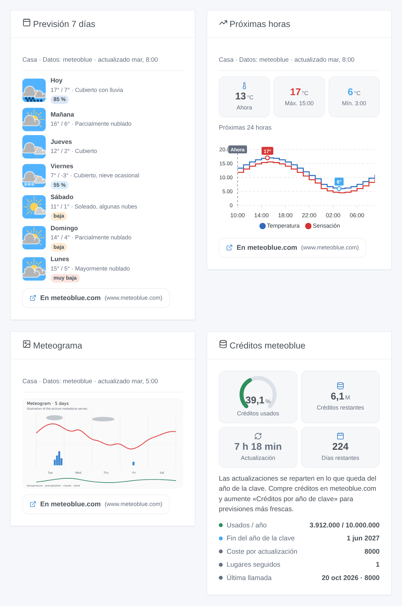
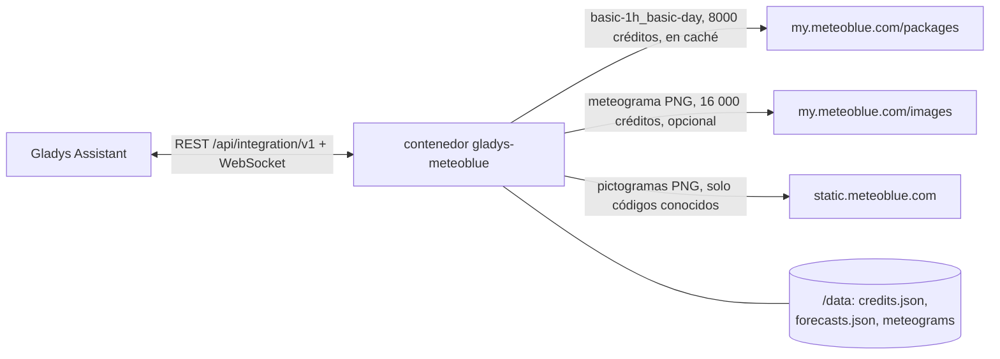
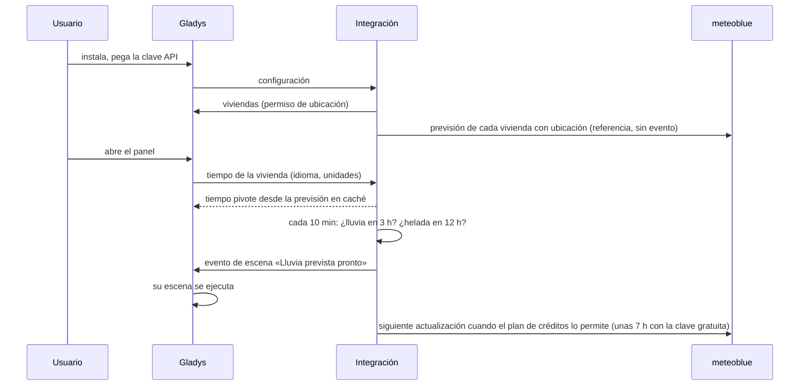

# Gladys Meteoblue

[English](README.md) · [Français](README.fr.md) · [Deutsch](README.de.md) · **Español**

[](LICENSE)
[](https://github.com/William-De71/gladys-meteoblue/releases)
[](https://github.com/William-De71/gladys-meteoblue/actions/workflows/release.yml)
[](https://gladysassistant.com)


Integración externa de [Gladys Assistant](https://gladysassistant.com) que convierte la **API Forecast de meteoblue** en un proveedor meteorológico de Gladys: el tiempo de la hora actual, previsiones de 24 horas y 7 días con la fiabilidad de meteoblue, activadores de escena de lluvia y helada, acciones de escena, cuatro widgets del panel y el meteograma de meteoblue. Funciona con la clave gratuita Weather API de meteoblue (10 millones de créditos al año) y reparte ella misma esos créditos a lo largo del año.

Documentación de usuario: [English](docs/en.md) · [Français](docs/fr.md) · [Deutsch](docs/de.md) · [Español](docs/es.md).

> Integración comunitaria, sin relación con meteoblue AG ni respaldada por ella. **Nunca probada con una clave API real**: sigue al pie de la letra la referencia de la API de meteoblue, y sus comentarios son bienvenidos. La clave gratuita es solo para uso no comercial.

## Funciones

- **Proveedor meteorológico** (tipo `weather`): la tarjeta meteorológica y el asistente conversacional de Gladys lo usan en lugar del servicio OpenWeather integrado. Temperatura, sensación térmica, humedad, presión, viento, índice UV, día o noche (de meteoblue), salida y puesta del sol (calculadas); 24 horas y 7 días; unidades métricas o estadounidenses.
- **Activadores de escena**: lluvia (o nieve) prevista en las próximas 3 horas, helada prevista en las próximas 12 horas, por vivienda; créditos meteoblue al 75, 90 o 100 %.
- **Acciones de escena**: la previsión de un día (hasta dentro de 6 días, con su fiabilidad), el tiempo actual, «¿va a llover en las próximas horas?».
- **Widgets**: una previsión de 7 días con los pictogramas de meteoblue y la fiabilidad, una curva de las próximas 12 a 48 horas, el meteograma, el presupuesto de créditos.
- **Meteograma** (opcional, desactivado por defecto): la imagen del meteograma de 5 días de meteoblue, en la tarjeta meteorológica y en su widget.
- **Créditos bajo control**: una sola llamada (8000 créditos) alimenta todo; el intervalo de actualización se calcula a partir de los créditos restantes hasta el final del año de la clave; previsiones y contador guardados en `/data` (un reinicio no cuesta nada); un tope anual estricto; un botón **Probar la clave API**.
- Inglés, francés, alemán y español en todas partes.



## Cómo funciona






No hay ningún dispositivo que descubrir: un proveedor meteorológico responde a las solicitudes meteorológicas de Gladys, que llevan las coordenadas de la vivienda.

### Transporte

Solo nube (`transports: ["cloud"]`, insignia «nube» en el catálogo): cada solicitud sale de su red hacia meteoblue con las coordenadas de la vivienda, redondeadas a unos 100 m. Los pictogramas los obtiene el contenedor y los sirve Gladys: el navegador nunca contacta con meteoblue.

### Créditos y actualización

meteoblue cuenta créditos, no llamadas ([referencia de la API Forecast](https://my.meteoblue.com/packages/redoc), «Credits and Call Limits», comprobada el 2026-10-20):

| Llamada                                                       | Créditos | Con los 10 millones gratuitos al año                            |
| ------------------------------------------------------------- | -------- | --------------------------------------------------------------- |
| Actualización de la previsión (por horas + 7 días, 1 llamada) | 8000     | unas 3 al día para una vivienda, más o menos cada 7 h           |
| Imagen del meteograma (opcional)                              | 16 000   | conservada 24 h = 5,8 millones al año, la mitad del presupuesto |
| «Probar la clave API»                                         | 8000     | a petición                                                      |

La integración cuenta el coste que meteoblue indica para cada respuesta (cabecera `MB-Credits-Accounted`), reparte los créditos restantes en lo que queda del año de la clave (2 % en reserva) y actualiza cada vivienda con ubicación cuando el plan lo permite, nunca más a menudo que el mínimo configurado. Los paquetes «current» y «sun & moon» no forman parte de la prueba gratuita: la hora actual viene de la previsión por horas (corregida por meteoblue con estaciones, radar y satélite) y las horas del sol se calculan.

## Requisitos

- Gladys **5.3.0** o posterior (las versiones anteriores no pueden instalar la integración: widgets, escenas, selector de vivienda y palabras clave del catálogo de Gladys 5.3).
- Una vivienda con ubicación en Gladys.
- Una cuenta meteoblue con acceso a la **Weather API** (la prueba gratuita: Account overview → Weather API), para uso no comercial. Paso a paso en la [documentación](docs/es.md#configuración).

## Instalación

- **Desde la tienda**: Integraciones → Meteoblue → Instalar.
- **Desde la URL del repositorio**: Integraciones → Añadir una integración externa → `https://github.com/William-De71/gladys-meteoblue`.
- **Modo desarrollador**: `npm install` y ejecútela junto a un Gladys en modo desarrollador con las variables de abajo.

## Configuración

| Campo                            | Por defecto | Función                                           |
| -------------------------------- | ----------- | ------------------------------------------------- |
| Clave API                        | —           | Su clave de meteoblue, un campo `secret`          |
| Créditos por año de clave        | 10 000 000  | Auméntelo tras comprar créditos; nunca se supera  |
| Inicio del año de la clave       | vacío       | AAAA-MM-DD; vacío = el primer día de uso          |
| Actualizar como mucho cada (min) | 60          | 30 a 1440: un mínimo, los créditos suelen decidir |
| Mostrar el meteograma            | no          | 16 000 créditos por imagen                        |
| Conservar un meteograma (horas)  | 24          | 3 a 168                                           |

Acción de configuración: **Probar la clave API** (una previsión, 8000 créditos: el tiempo de la primera vivienda, los créditos usados y el intervalo de actualización).

## Uso

Pegue la clave, pulse **Probar la clave API** y después añada los widgets a un panel y cree escenas con los activadores «Lluvia prevista pronto» o «Helada prevista» o con las acciones meteorológicas. La tarjeta meteorológica de Gladys usa este proveedor automáticamente (o fíjelo en los ajustes de la tarjeta si hay varios proveedores instalados). meteoblue no publica avisos oficiales en esta API: el activador de alerta meteorológica de Gladys permanece en silencio, los activadores de lluvia y helada son previsiones. Cada widget de previsión cita a meteoblue y enlaza a la página de meteoblue del mismo lugar, como piden las condiciones de uso no comercial.

## Desarrollo

```bash
npm install
npm test                     # node --test, nunca usa la red
npm run lint && npm run format:check
npx github:GladysAssistant/integration-store . --skip-image-check
docs/illustrations/render.sh # ilustraciones de los widgets
scripts/build-cover.sh       # cover.jpg
```

Variables de entorno (definidas por el supervisor de Gladys): `GLADYS_HOST_API_URL`, `GLADYS_INTEGRATION_TOKEN`, `GLADYS_INTEGRATION_SELECTOR` y `TZ` (la zona horaria pedida a meteoblue: los días se dividen en ella). La integración solo escribe en `/data`: `credits.json` (el contador de créditos), `forecasts.json` (la última previsión de cada lugar) y `meteograms/`.

## Proceso de publicación


Cada fusión en `main` ejecuta la CI y luego calcula la versión a partir de los [Conventional Commits](https://www.conventionalcommits.org/es/) desde la última etiqueta: `feat` → menor, `fix` / `perf` → parche, `!` o `BREAKING CHANGE` → mayor (una menor por debajo de 1.0.0); `docs`, `chore`, `ci`, `test`, `style`, `refactor`, `build` solos no publican nada. Sin etiqueta, la 0.1.0 se publica tal cual. Se genera la sección del changelog, se envía la etiqueta, se construye la imagen multiarquitectura y después `main` recibe el commit de publicación (la tienda nunca ve una versión sin su imagen), se crea la GitHub Release y un último trabajo comprueba la imagen pública, el validador de la tienda y el topic.

- El título de la pull request se convierte en el commit squash y luego en la línea del changelog: escríbalo en inglés, para el usuario (`pr-title.yml` lo comprueba). No edite nunca `CHANGELOG.md` a mano.
- La 1.0.0 es una decisión: Actions → Release → Run workflow con `release-as: 1.0.0`. `dry-run` muestra la versión y las notas sin publicar nada.
- **Rama protegida**: el ruleset `protect-main` solo prohíbe borrar `main` y el force-push, así que el commit de publicación pasa. Una regla más estricta (pull request obligatoria, status checks) necesitaría GitHub Actions en su lista de excepciones (o una GitHub App).
- Tras la primera publicación, el paquete `ghcr.io` debe ser público (Package settings → Change visibility).

## Solución de problemas

Véase [docs/es.md](docs/es.md#solución-de-problemas) (clave rechazada, caducada o firmada, créditos agotados, previsión antigua). Informe de los problemas con las versiones de Gladys y de la integración, el país de la vivienda y el resultado de **Probar la clave API** (Configuración → Supervisión para los registros). No pegue nunca la clave.

## Contribuir

Las issues y pull requests son bienvenidas. Ejecute `npm run format:check && npm run lint && npm test` antes de abrir una pull request y no cambie ninguna clave almacenada (véase [CLAUDE.md](CLAUDE.md)).

## Seguridad

Véase [SECURITY.md](SECURITY.md): informe de las vulnerabilidades en privado. La clave API es un campo `secret`; meteoblue la exige en la URL, por lo que nunca se registra una URL ni se pone en un mensaje de error. Los pictogramas solo se obtienen de `https://static.meteoblue.com/assets/images/picto/<código conocido>.png`, los meteogramas solo para los lugares que la integración registró.

## Capturas de pantalla pendientes

Las imágenes de arriba son ilustraciones, no capturas. Las capturas reales irán en `docs/assets/screenshots/` (PNG, 1280 × 800): `configuration.png`, `test-api-key.png`, `weather-card.png`, `scene-trigger.png`.

## Licencia

[Licencia Apache 2.0](LICENSE) — véase también [NOTICE](NOTICE). Datos meteorológicos y pictogramas © meteoblue AG ([pictogramas](https://docs.meteoblue.com/en/meteo/variables/pictograms), [uso no comercial](https://content.meteoblue.com/en/about-us/legal/commercial-non-commercial-use)); meteoblue es una marca de meteoblue AG, con la que esta integración comunitaria no tiene relación. Gracias a la documentación y al SDK de Gladys.
