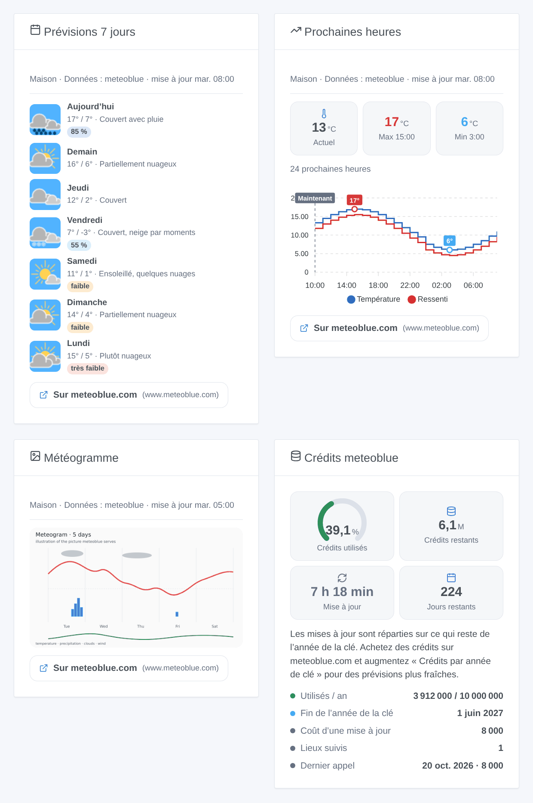
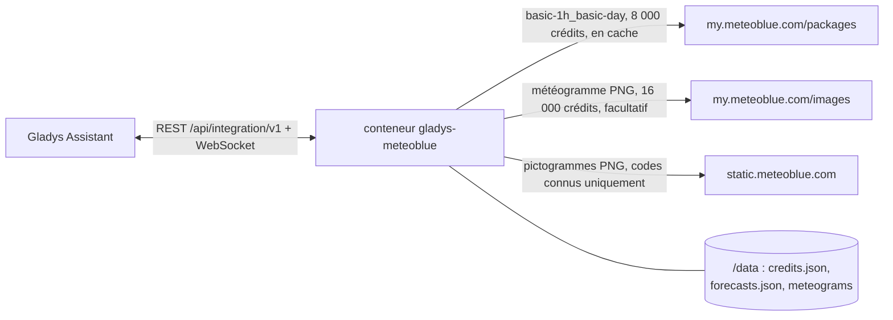
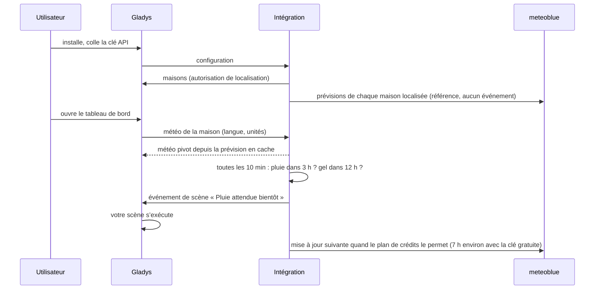

# Gladys Meteoblue

[English](README.md) · **Français** · [Deutsch](README.de.md) · [Español](README.es.md)

[](LICENSE)
[](https://github.com/William-De71/gladys-meteoblue/releases)
[](https://github.com/William-De71/gladys-meteoblue/actions/workflows/release.yml)
[](https://gladysassistant.com)


Intégration externe de [Gladys Assistant](https://gladysassistant.com) qui fait de l’**API Forecast de meteoblue** un fournisseur météo de Gladys : la météo de l’heure en cours, des prévisions sur 24 heures et 7 jours avec la fiabilité de meteoblue, des déclencheurs de scène pluie et gel, des actions de scène, quatre widgets de tableau de bord et le météogramme meteoblue. Elle tourne avec la clé gratuite Weather API de meteoblue (10 millions de crédits par an) et répartit elle-même ces crédits sur l’année.

Documentation utilisateur : [English](docs/en.md) · [Français](docs/fr.md) · [Deutsch](docs/de.md) · [Español](docs/es.md).

> Intégration communautaire, sans lien avec meteoblue AG ni approuvée par elle. **Jamais testée avec une vraie clé API** : elle suit la référence de l’API meteoblue à la lettre, vos retours sont bienvenus. La clé gratuite est réservée à un usage non commercial.

## Fonctionnalités

- **Fournisseur météo** (type `weather`) : la carte météo et l’assistant conversationnel de Gladys l’utilisent à la place du service OpenWeather intégré. Température, ressenti, humidité, pression, vent, indice UV, jour ou nuit (fourni par meteoblue), lever et coucher du soleil (calculés) ; 24 heures et 7 jours ; unités métriques ou américaines.
- **Déclencheurs de scène** : pluie (ou neige) attendue dans les 3 heures, gel attendu dans les 12 heures, par maison ; crédits meteoblue à 75, 90 ou 100 %.
- **Actions de scène** : la prévision d’un jour (jusqu’à 6 jours, avec sa fiabilité), la météo actuelle, « va-t-il pleuvoir dans les prochaines heures ? ».
- **Widgets** : prévisions 7 jours avec les pictogrammes meteoblue et la fiabilité, courbe des 12 à 48 prochaines heures, météogramme, budget de crédits.
- **Météogramme** (facultatif, désactivé par défaut) : l’image du météogramme 5 jours de meteoblue, dans la carte météo et dans son widget.
- **Crédits maîtrisés** : un seul appel (8 000 crédits) alimente tout ; l’intervalle de mise à jour est calculé à partir des crédits restants jusqu’à la fin de l’année de la clé ; prévisions et compteur gardés dans `/data` (un redémarrage ne coûte rien) ; un plafond annuel strict ; un bouton **Tester la clé API**.
- Anglais, français, allemand et espagnol partout.



## Fonctionnement






Il n’y a pas d’appareil à découvrir : un fournisseur météo répond aux demandes météo de Gladys, qui portent les coordonnées de la maison.

### Transport

Cloud uniquement (`transports: ["cloud"]`, badge « cloud » dans le catalogue) : chaque requête sort de votre réseau vers meteoblue avec les coordonnées de la maison, arrondies à 100 m environ. Les pictogrammes sont récupérés par le conteneur et servis par Gladys : le navigateur ne contacte jamais meteoblue.

### Crédits et mises à jour

meteoblue compte des crédits, pas des appels ([référence de l’API Forecast](https://my.meteoblue.com/packages/redoc), « Credits and Call Limits », vérifiée le 2026-10-20) :

| Appel                                                   | Crédits | Avec les 10 millions gratuits par an                       |
| ------------------------------------------------------- | ------- | ---------------------------------------------------------- |
| Mise à jour des prévisions (horaire + 7 jours, 1 appel) | 8 000   | environ 3 par jour pour une maison, toutes les 7 h environ |
| Image du météogramme (facultative)                      | 16 000  | gardée 24 h = 5,8 millions par an, la moitié du budget     |
| « Tester la clé API »                                   | 8 000   | à la demande                                               |

L’intégration compte le coût que meteoblue indique pour chaque réponse (en-tête `MB-Credits-Accounted`), répartit les crédits restants sur le reste de l’année de la clé (2 % en réserve) et met à jour chaque maison localisée quand le plan le permet, jamais plus souvent que le plancher configuré. Les paquets « current » et « sun & moon » ne font pas partie de l’essai gratuit : l’heure en cours vient de la prévision horaire (corrigée par meteoblue avec les stations, le radar et le satellite) et les heures du soleil sont calculées.

## Prérequis

- Gladys **5.2.0** ou plus récent (les versions antérieures ne peuvent pas installer l’intégration : widgets, scènes et sélecteur de maison).
- Une maison localisée dans Gladys.
- Un compte meteoblue avec l’accès **Weather API** (l’essai gratuit : Account overview → Weather API), pour un usage non commercial. Pas à pas dans la [documentation](docs/fr.md#configuration).

## Installation

- **Depuis le store** : Intégrations → Meteoblue → Installer.
- **Depuis l’URL du dépôt** : Intégrations → Ajouter une intégration externe → `https://github.com/William-De71/gladys-meteoblue`.
- **Mode développeur** : `npm install`, puis lancez-la à côté d’un Gladys en mode développeur avec les variables ci-dessous.

## Configuration

| Champ                                | Défaut     | Rôle                                                           |
| ------------------------------------ | ---------- | -------------------------------------------------------------- |
| Clé API                              | —          | Votre clé meteoblue, un champ `secret`                         |
| Crédits par année de clé             | 10 000 000 | À augmenter après un achat de crédits ; jamais dépassé         |
| Début de l’année de la clé           | vide       | AAAA-MM-JJ ; vide = le premier jour d’utilisation              |
| Mise à jour au plus toutes les (min) | 60         | 30 à 1 440 : un plancher, les crédits décident le plus souvent |
| Afficher le météogramme              | non        | 16 000 crédits par image                                       |
| Garder un météogramme (heures)       | 24         | 3 à 168                                                        |

Action de configuration : **Tester la clé API** (une prévision, 8 000 crédits : la météo de la première maison, les crédits utilisés et l’intervalle de mise à jour).

## Utilisation

Collez la clé, cliquez sur **Tester la clé API**, puis ajoutez les widgets à un tableau de bord et créez des scènes avec les déclencheurs « Pluie attendue bientôt » ou « Gel attendu » ou les actions météo. La carte météo de Gladys utilise ce fournisseur automatiquement (ou épinglez-le dans les réglages de la carte si plusieurs fournisseurs sont installés). meteoblue ne publie pas d’alerte officielle dans cette API : le déclencheur d’alerte météo de Gladys reste muet, les déclencheurs pluie et gel sont des prévisions. Chaque widget de prévision cite meteoblue et renvoie vers la page meteoblue du même lieu, comme le demandent les conditions d’usage non commercial.

## Développement

```bash
npm install
npm test                     # node --test, ne touche jamais le réseau
npm run lint && npm run format:check
npx github:GladysAssistant/integration-store . --skip-image-check
docs/illustrations/render.sh # illustrations des widgets
scripts/build-cover.sh       # cover.jpg
```

Variables d’environnement (fournies par le superviseur de Gladys) : `GLADYS_HOST_API_URL`, `GLADYS_INTEGRATION_TOKEN`, `GLADYS_INTEGRATION_SELECTOR` et `TZ` (le fuseau demandé à meteoblue : les jours y sont découpés). L’intégration n’écrit que dans `/data` : `credits.json` (le compteur de crédits), `forecasts.json` (la dernière prévision de chaque lieu) et `meteograms/`.

## Processus de release


Chaque fusion sur `main` lance la CI, puis calcule la version d’après les [Conventional Commits](https://www.conventionalcommits.org/fr/) depuis le dernier tag : `feat` → mineure, `fix` / `perf` → correctif, `!` ou `BREAKING CHANGE` → majeure (une mineure sous 1.0.0) ; `docs`, `chore`, `ci`, `test`, `style`, `refactor`, `build` seuls ne publient rien. Sans tag, la 0.1.0 est publiée telle quelle. La section du changelog est générée, le tag poussé, l’image multi-architecture construite, puis `main` reçoit le commit de release (le store ne voit donc jamais une version sans son image), la GitHub Release est créée et un dernier job vérifie l’image publique, le validateur du store et le topic.

- Le titre de la pull request devient le commit squash, puis la ligne du changelog : écrivez-le en anglais, pour l’utilisateur (`pr-title.yml` le vérifie). Ne modifiez jamais `CHANGELOG.md` à la main.
- La 1.0.0 est une décision : Actions → Release → Run workflow avec `release-as: 1.0.0`. `dry-run` affiche la version et les notes sans rien publier.
- **Branche protégée** : le ruleset `protect-main` n’interdit que la suppression de `main` et le force-push, le commit de release passe donc. Une règle plus stricte (pull request obligatoire, status checks) demanderait d’ajouter GitHub Actions à sa liste de contournement (ou une GitHub App).
- Après la première release, le package `ghcr.io` doit être public (Package settings → Change visibility).

## Dépannage

Voir [docs/fr.md](docs/fr.md#dépannage) (clé refusée, expirée ou signée, crédits épuisés, prévision ancienne). Signalez un problème avec les versions de Gladys et de l’intégration, le pays de la maison et le résultat de **Tester la clé API** (Paramètres → Supervision pour les journaux). Ne collez jamais la clé elle-même.

## Contribuer

Issues et pull requests bienvenues. Lancez `npm run format:check && npm run lint && npm test` avant d’ouvrir une pull request, et ne changez aucune clé stockée (voir [CLAUDE.md](CLAUDE.md)).

## Sécurité

Voir [SECURITY.md](SECURITY.md) : signalez les vulnérabilités en privé. La clé API est un champ `secret` ; meteoblue l’exige dans l’URL, donc aucune URL n’est jamais journalisée ni mise dans un message d’erreur. Les pictogrammes ne sont récupérés que depuis `https://static.meteoblue.com/assets/images/picto/<code connu>.png`, les météogrammes que pour les lieux enregistrés par l’intégration.

## Captures d’écran à venir

Les images ci-dessus sont des illustrations, pas des captures. Les vraies captures iront dans `docs/assets/screenshots/` (PNG, 1280 × 800) : `configuration.png`, `test-api-key.png`, `weather-card.png`, `scene-trigger.png`.

## Licence

[Licence Apache 2.0](LICENSE) — voir aussi [NOTICE](NOTICE). Données météo et pictogrammes © meteoblue AG ([pictogrammes](https://docs.meteoblue.com/en/meteo/variables/pictograms), [usage non commercial](https://content.meteoblue.com/en/about-us/legal/commercial-non-commercial-use)) ; meteoblue est une marque de meteoblue AG, avec laquelle cette intégration communautaire n’a aucun lien. Merci à la documentation et au SDK de Gladys.
