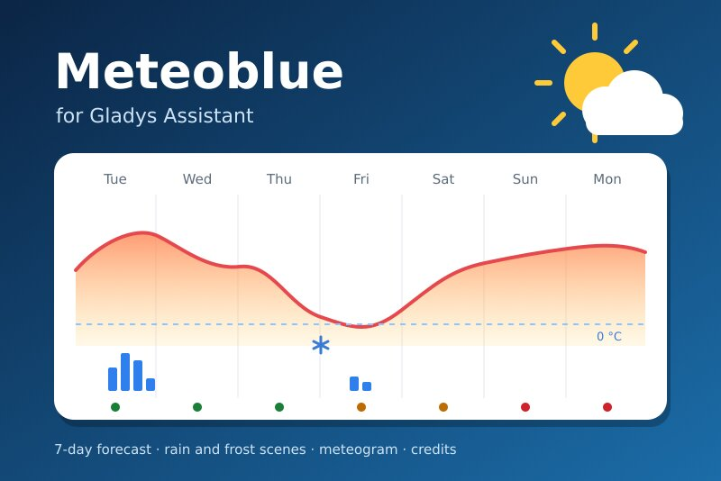
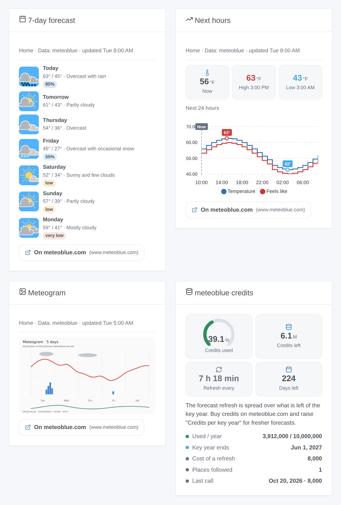
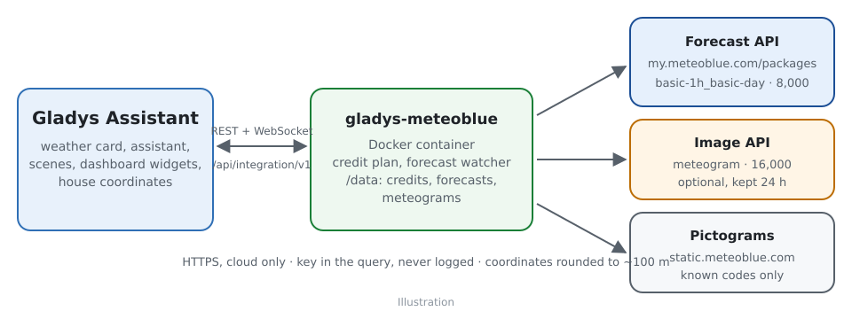
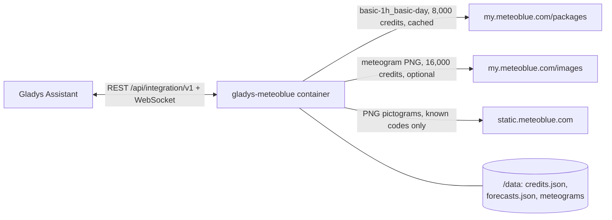
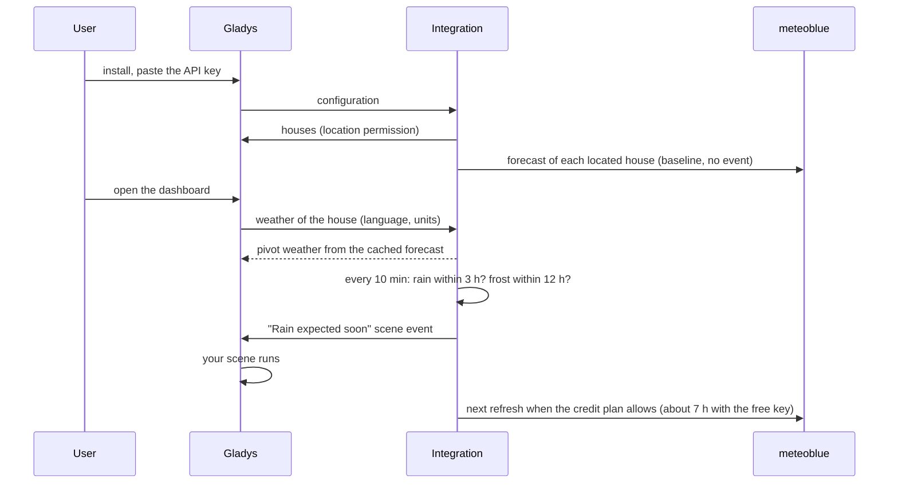

# Gladys Meteoblue

**English** · [Français](README.fr.md) · [Deutsch](README.de.md) · [Español](README.es.md)

[](LICENSE)
[](https://github.com/William-De71/gladys-meteoblue/releases)
[](https://github.com/William-De71/gladys-meteoblue/actions/workflows/release.yml)
[](https://gladysassistant.com)



[Gladys Assistant](https://gladysassistant.com) external integration that makes the **meteoblue Forecast API** a weather provider of Gladys: the weather of the present hour, 24-hour and 7-day forecasts with meteoblue's predictability, rain and frost scene triggers, scene actions, four dashboard widgets and the meteoblue meteogram. It runs on the free Weather API key of meteoblue (10 million credits a year) and spreads those credits over the year itself.

User documentation: [English](docs/en.md) · [Français](docs/fr.md) · [Deutsch](docs/de.md) · [Español](docs/es.md).

> Community integration, not affiliated with nor endorsed by meteoblue AG. **Never tested with a real API key yet**: it follows the meteoblue API reference to the letter, and feedback is welcome. The free key is for non-commercial use.

## Features

- **Weather provider** (type `weather`): Gladys's weather card and chat assistant use it instead of the built-in OpenWeather service. Temperature, feels like, humidity, pressure, wind, UV index, day or night (from meteoblue), sunrise and sunset (computed); 24 hours and 7 days; metric or US units.
- **Scene triggers**: rain (or snow) expected within 3 hours, frost expected within 12 hours, both by house; meteoblue credits at 75, 90 or 100 %.
- **Scene actions**: the forecast of a day (up to 6 days ahead, with its predictability), the current weather, "is rain expected in the next hours?".
- **Widgets**: a 7-day forecast with the meteoblue pictograms and predictability, a curve of the next 12 to 48 hours, the meteogram, the credit budget.
- **Meteogram** (optional, off by default): the 5-day meteogram picture of meteoblue, in the weather card and in its widget.
- **Credits under control**: one call (8,000 credits) feeds everything; the refresh interval is computed from the credits left until the end of the key year; forecasts and counter kept in `/data` (a restart costs nothing); a hard yearly cap; a **Test the API key** button.
- English, French, German and Spanish everywhere.



## How it works







There is no device to discover: a weather provider answers Gladys's weather requests, which carry the coordinates of the house.

### Transport

Cloud only (`transports: ["cloud"]`, "cloud" badge in the catalog): every request leaves your network for meteoblue with the coordinates of the house, rounded to about 100 m. The pictograms are fetched by the container and served by Gladys: the browser never contacts meteoblue.

### Credits and refresh

meteoblue counts credits, not calls ([Forecast API reference](https://my.meteoblue.com/packages/redoc), "Credits and Call Limits", checked on 2026-10-20):

| Call                                       | Credits | With the free 10 million a year                 |
| ------------------------------------------ | ------- | ----------------------------------------------- |
| Forecast refresh (hourly + 7 days, 1 call) | 8,000   | about 3 a day for one house, every 7 h or so    |
| Meteogram picture (optional)               | 16,000  | 24 h kept = 5.8 million a year, half the budget |
| "Test the API key"                         | 8,000   | on demand                                       |

The integration counts the cost meteoblue accounts for each answer (header `MB-Credits-Accounted`), spreads the credits left over the rest of the key year (2 % kept in reserve), and refreshes each located house when the plan allows, never more often than the configured floor. The "current" and "sun & moon" packages are not in the free trial: the present hour comes from the hourly forecast (corrected by meteoblue with stations, radar and satellite) and the sun times are computed.

## Requirements

- Gladys **5.3.0** or later (older versions cannot install the integration: widgets, scenes, the house selector and the catalog keywords of Gladys 5.3).
- A house with a location in Gladys.
- A meteoblue account with the **Weather API** access (the free trial: Account overview → Weather API), for non-commercial use. Step by step in the [documentation](docs/en.md#configuration).

## Installation

- **From the store**: Integrations → Meteoblue → Install.
- **From the repository URL**: Integrations → Add an external integration → `https://github.com/William-De71/gladys-meteoblue`.
- **Developer mode**: `npm install`, then run it next to a Gladys in developer mode with the variables below.

## Configuration

| Field                       | Default    | Purpose                                            |
| --------------------------- | ---------- | -------------------------------------------------- |
| API key                     | —          | Your meteoblue key, a `secret` field               |
| Credits per key year        | 10,000,000 | Raise it after buying credits; never spent beyond  |
| Start of the key year       | empty      | YYYY-MM-DD; empty = the first day the key was used |
| Refresh at most every (min) | 60         | 30 to 1,440: a floor, the credits usually decide   |
| Show the meteogram          | off        | 16,000 credits a picture                           |
| Keep a meteogram for (h)    | 24         | 3 to 168                                           |

Configuration action: **Test the API key** (one forecast, 8,000 credits: the weather of the first house, the credits used and the refresh interval).

## Usage

Paste the key, click **Test the API key**, then add the widgets to a dashboard and create scenes with the "Rain expected soon" or "Frost expected" triggers or the weather actions. The weather card of Gladys uses this provider automatically (or pin it in the card settings when several providers are installed). meteoblue publishes no official warning in this API: Gladys's weather-alert trigger stays silent with it, the rain and frost triggers are forecasts. Every forecast widget names meteoblue and links to the meteoblue page of the same place, as the non-commercial conditions ask.

## Development

```bash
npm install
npm test                     # node --test, never touches the network
npm run lint && npm run format:check
npx github:GladysAssistant/integration-store . --skip-image-check
docs/illustrations/render.sh # widget illustrations
scripts/build-cover.sh       # cover.jpg
```

Environment variables (set by the Gladys supervisor): `GLADYS_HOST_API_URL`, `GLADYS_INTEGRATION_TOKEN`, `GLADYS_INTEGRATION_SELECTOR`, and `TZ` (the time zone asked of meteoblue: days are cut in it). The integration writes only in `/data`: `credits.json` (the credit counter), `forecasts.json` (the last forecast of each place) and `meteograms/`.

## Release process


Every merge on `main` runs the CI, then computes the version from the [Conventional Commits](https://www.conventionalcommits.org/) since the last tag: `feat` → minor, `fix` / `perf` → patch, `!` or `BREAKING CHANGE` → major (a minor below 1.0.0); `docs`, `chore`, `ci`, `test`, `style`, `refactor`, `build` alone publish nothing. With no tag yet, 0.1.0 is released as is. The changelog section is generated, the tag pushed, the multi-architecture image built, then `main` receives the release commit (so the store never sees a version without its image), the GitHub Release is created and a last job checks the public image, the store validator and the topic.

- The pull request title becomes the squash commit, then the changelog line: write it in English, for the user (`pr-title.yml` checks it). Never edit `CHANGELOG.md` by hand.
- 1.0.0 is a decision: Actions → Release → Run workflow with `release-as: 1.0.0`. `dry-run` shows the version and the notes without publishing.
- **Protected branch**: the `protect-main` ruleset only forbids deleting `main` and force-pushing, so the release commit goes through. A stricter rule (required pull request, status checks) would need GitHub Actions in its bypass list (or a GitHub App).
- After the first release, the `ghcr.io` package must be public (Package settings → Change visibility).

## Troubleshooting

See [docs/en.md](docs/en.md#troubleshooting) (key refused, expired or signed, credits spent, old forecast). Report issues with the versions of Gladys and of the integration, the country of the house and the result of **Test the API key** (Settings → Supervision for the logs). Never paste the key itself.

## Contributing

Issues and pull requests are welcome. Run `npm run format:check && npm run lint && npm test` before opening a pull request, and keep every stored key unchanged (see [CLAUDE.md](CLAUDE.md)).

## Security

See [SECURITY.md](SECURITY.md): report vulnerabilities privately. The API key is a `secret` field; meteoblue requires it in the query string, so no URL is ever logged or put in an error message. Pictograms are fetched only from `https://static.meteoblue.com/assets/images/picto/<known code>.png`, meteograms only for places the integration registered.

## Screenshots to come

The images above are illustrations, not screenshots. Real screenshots will go in `docs/assets/screenshots/` (PNG, 1280 × 800): `configuration.png`, `test-api-key.png`, `weather-card.png`, `scene-trigger.png`.

## License

[Apache License 2.0](LICENSE) — see also [NOTICE](NOTICE). Weather data and pictograms © meteoblue AG ([pictograms](https://docs.meteoblue.com/en/meteo/variables/pictograms), [non-commercial use](https://content.meteoblue.com/en/about-us/legal/commercial-non-commercial-use)); meteoblue is a trademark of meteoblue AG, which this community integration is not affiliated with. Thanks to the Gladys documentation and SDK.
